 
 


<p align="center">
  <picture>
    <source media="(prefers-color-scheme: dark)" srcset="images/hero-dark.svg" />
    
  </picture>
</p>

# Mac desktop widgets

I wanted a desktop that tells me something at a glance without looking like a dashboard: a big thin clock, the Mac's health in one row of rings, how much of my Claude plan is left, and a new wallpaper every day with the story behind it, Windows Spotlight style. No cards and no boxes, just text straight on the photo with a soft shadow.

My motive was also to learn how much a Mac tells you with built-in commands only (`ps`, `vm_stat`, `ioreg`, `netstat`, `scutil`) and to build it in an afternoon with Claude Code. No sudo, no accounts, no API keys.

## What it looks like

<p align="center">
  
</p>
<p align="center"><sub>A real screenshot of my desktop. Photo: Sailing into sunset, Marmaris, Türkiye (© Anton Petrus / Moment / Getty Images), Windows Spotlight picture.</sub></p>

| Widget | What it shows |
|---|---|
| **Clocks** (`desk-clocks.jsx`) | Big local time in 12-hour format, the date, and up to three more time zones with a sun or moon |
| **This Mac** (`desk-system.jsx`) | Ring gauges for CPU, GPU and memory (app / system / compressed); network ↓↑ for the connection in use; pressure · swap · busiest app · biggest-memory app; uptime; disk behind a button |
| **Apps / Free up** (`desk-memapps.py`) | Your apps ranked by real memory footprint (helpers grouped under their app); quit one with a two-click confirm. **Clear swap** appears only when swap is over 1 GB |
| **Claude** (`desk-claude.jsx`) | Your Claude plan: 5-hour and weekly limit rings with time to reset; one line per open Claude Code session (name · context % · $ · green dot, glowing while Claude works); closed sessions in a dropdown. Moves down when a stats panel opens |
| **Status line** (`statusline/claude-statusline.py`) | The same numbers on one line at the bottom of Claude Code, and the data source for the card |
| **Speed** (`desk-speedtest.py`) | One click runs macOS's own `networkQuality` test (~15 s) and keeps the result |
| **Wallpaper** (`desk-wallpaper.widget/`) | Bing picture of the day in 4K, or a fresh Windows Spotlight picture; magazine-style caption; ‹ › history, ♥ favourites, (i) story, ↗ learn more; keeps the last 30 |

## The guide

[Part 1](docs/Part1-Install.md): Installing Übersicht and the widgets

[Part 2](docs/Part2-Clocks.md): The clock: time zones without any API

[Part 3](docs/Part3-System-Stats.md): CPU, GPU, memory, network and swap from built-in commands, and the Free up panel

[Part 4](docs/Part4-Wallpaper.md): A daily wallpaper with its story, made safe

[Part 5](docs/Part5-Claude-Usage.md): Claude Code usage on the desktop: plan limits, open sessions, and a card that moves out of the way

Also: [Do's and Don'ts](docs/Dos-and-Donts.md) · [Questions & Answers](docs/Questions-and-Answers.md) · [Troubleshooting](docs/Troubleshooting.md)

## Quick start

```bash
brew install --cask ubersicht
git clone https://github.com/Parag-S-Salunkhe/mac-desktop-widgets
cp -R mac-desktop-widgets/widgets/* "$HOME/Library/Application Support/Übersicht/widgets/"
```

Open Übersicht. The widgets appear on the right edge of the desktop. Edit `ZONES` in `desk-clocks.jsx` to pick your time zones.

If you use Claude Code, add the status line too ([Part 5](docs/Part5-Claude-Usage.md)); the Claude card fills in after the next reply.

## How it helps

- **Answers without opening anything.** The time where your team is, whether the Mac is struggling and which app is to blame, all on the desktop you already look at.
- **Catches a slow Mac early.** Memory pressure and swap show up before the spinning wheel does, and Free up quits the heaviest app in two clicks.
- **Shows how much Claude is left.** The 5-hour and weekly limits with a countdown, so you can pace a long task instead of hitting the limit halfway.
- **Checks the connection before a call.** One click on Speed tells you if the Wi-Fi or the hub is the problem.
- **Something new every day.** A fresh photo each morning, with its story one click away.
- **Costs almost nothing.** See below.

## What more you can build on it

Übersicht runs any shell command and draws the output with React, so anything your Mac can tell you can become a widget. Most of these need no account and no API key:

- **VPN or network dot:** green when the tunnel is up, from `scutil` and `ifconfig`.
- **CI status:** your latest GitHub Actions runs with `gh run list`, red when one fails.
- **To-do list:** the top items from a markdown file, oldest first.
- **Today's agenda:** the next meetings from the macOS Calendar.
- **Now Playing:** the track from Music or Spotify through `osascript`, with play and skip.
- **Focus timer:** 25 minutes on the desktop, the other widgets dimmed while it runs.
- **Battery health:** cycle count and condition from `system_profiler SPPowerDataType`.
- **Unread counts:** Mail's unread badge through `osascript`, without opening Mail.

The pattern is always the same: one cheap command, a refresh rate that matches how fast the thing changes, and text straight on the photo.

## Light on battery

- The stats widget runs cheap commands every 10 s: about **11 ms of CPU every 5 s** in total. Übersicht itself stays under 0.2% CPU.
- The Claude card reads a few local files every 15 s: about **0.04 s of CPU each time**, no network. The status line runs only after a Claude reply.
- Nothing animates constantly. The wallpaper checks the network once a day.
- The real drain I found while building this wasn't the widgets: it was **System Settings left open on the Wallpaper pane**, which keeps playing the aerial previews (6–8% CPU). Quit System Settings after changing the wallpaper.

## Security

- Übersicht's local server listens only on `127.0.0.1` and refuses requests from other websites.
- The wallpaper script downloads over **HTTPS only**, follows HTTPS-only redirects, caps file sizes, checks the image's magic bytes, keeps file names to letters and digits, and writes files atomically.
- Links are opened only if they are plain `https://` links.
- The Claude card and status line read only local files Claude Code already writes. Nothing leaves the Mac, and session paths are never passed to the card.
- The Free up panel can only quit apps installed in an Applications folder, never system processes, and it re-checks the app before quitting. It asks the app to quit like Cmd+Q, so you can still save your work.

Time and cost: one afternoon, $0.

## Built with

[Übersicht](https://tracesof.net/uebersicht/) (JSX widgets), Python's standard library, macOS's built-in commands, and [Claude Code](https://claude.com/claude-code) as my pair programmer. I picked every design option (there were four of each; for the Claude card, 18) and Claude wrote and tested the code.
